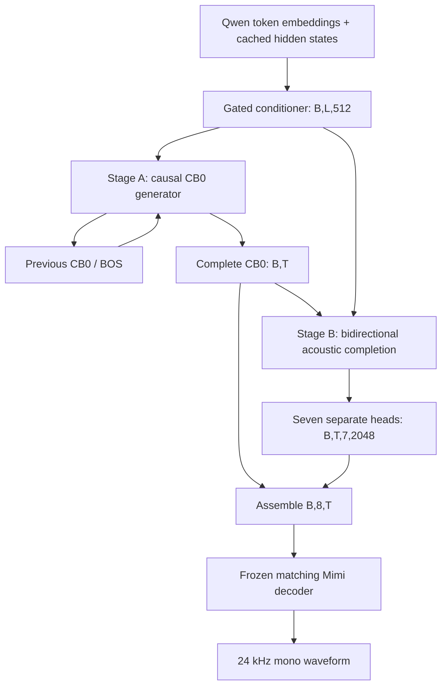

# v2 module and gradient contracts

This is an offline experimental architecture. It replaces v1's duration/owner
conditioning and sequential within-frame residual-code predictor.

| Module | Input | Output | Learned in |
|---|---|---|---|
| Qwen input-table lookup/cache | IDs `[B,L]` | embeddings `[B,L,1536]` | frozen |
| Conditioner | hidden + embeddings + token mask | Z `[B,L,512]` | A only |
| CB0 teacher-forcing shift | reference CB0 `[B,T]` | BOS + previous CB0 representations `[B,T,512]` | A embedding/BOS |
| CB0 temporal model | shifted CB0, Z, masks | states `[B,T,512]` | A |
| CB0 head | temporal states | logits `[B,T,2048]` | A |
| Stop head | temporal states | stop logits `[B,T]` | A |
| Acoustic completion | complete CB0, frozen Z, masks | logits `[B,T,7,2048]` | B |
| Assembly | CB0 `[B,T]`, acoustic `[B,7,T]` | codes `[B,8,T]` | none |
| Mimi decoder | codes `[1,8,T]` | waveform (backend normalized to mono) | frozen |

`T` is a reference length only during training. Inference predicts its own length
using CB0 termination; reference lengths, timestamps, or duration owners are not
passed to generation. Public free-running inference initially requires B=1.

## Conditioner

`p = Pe(E)`, `q = Ph(RMSNorm(H))`,
`Z = p + sigmoid(Wg[p;q]+bg) * q + sinusoidal_position`.
All projected widths are 512. Gate weight starts at zero and bias at -3.
Every subword is preserved. Qwen and Mimi are not children of the trainable model;
the training inputs are cached fixed features. `get_input_embeddings()` or direct
safetensors extraction yields selected-token embeddings, not contextual states.
Record whether H predicts the selected token or follows consumption of that token.

## Stage A

Four causal blocks, eight heads, width 512, SwiGLU intermediate 1536, pre-RMSNorm,
RoPE for audio self-attention, cross-attention to the complete valid Z sequence.
CB0 IDs use a 128-wide embedding projected to 512. Teacher-forced input frame t is
CB0[t-1]; first input is a distinct learned BOS (ID zero remains a valid code).
No current/future CB0 target enters its own prediction. Cached single-frame
inference is checked numerically against the full teacher-forced forward pass.

`loss_A = masked_CE(CB0) + 0.1 * balanced_masked_stop_BCE`.
Stop is positive at the final valid frame, and means stop AFTER emitting that frame.
Padding is ignored. Max-frame guard termination is reported separately.

## Stage B

Freeze conditioner and Stage A, including dropout/eval mode. Use its own 128-wide
CB0 embedding -> 512 projection plus frame positions. Two width-512 blocks,
eight-head bidirectional valid-frame self-attention, text cross-attention,
SwiGLU intermediate 1536, pre-RMSNorm. Seven independent categorical heads predict
CB1-CB7 at every frame. Ground-truth residuals are loss targets only.

`loss_B = (CE1 + ... + CE7) / 7` over valid frames.
There is no combined CB0/acoustic loss in this POC. CB0 priority is achieved through
separate training and freezing. A published 100:1 joint weighting is not an automatic
requirement for a stage with only CB0 targets and a separate acoustic optimizer.

## Padding, data, and evaluation

- Stored NPZ codes use explicitly configured `[8,T]` or `[T,8]`; model batches use
  `[B,8,T]`. Existing legacy `[frames,8]` mmap data is transposed once.
- Conditioner and audio blocks mask padding; losses select valid positions before
  CE, so pad labels cannot leak into supervised statistics.
- Do not use frame-level random train/test splits. Hold out source utterances.
- Test reference reconstruction first, acoustic completion with reference CB0
  second, and full generated CB0 plus acoustics last.
- Check per-codebook validation CE, generated length/termination, repetition,
  code-usage collapse, external speech WER, listening quality and voice consistency.
- Timestamps remain dataset validation/diagnostic metadata. This model does not
  impose one text token per frame, nor does it use timestamps at inference.
- Real speech quality and mobile speed require actual data and matching codec.

## Streaming status

Stage A can generate CB0 incrementally after complete text conditioning. Stage B
waits for complete CB0 and uses future CB0 frames. Therefore the full model is
offline. A completed-word release buffer is not implemented in this baseline:
adding it without retraining a bounded-context acoustic stage would not make the
system stream text input to audio output.

## Research grounding

- [Moshi/Mimi](https://kyutai.org/Moshi.pdf), sections 3.3.2 and 5.3: split semantic
  and acoustic quantization, semantic weighting and depth-model ablations.
- [Llama-Mimi](https://arxiv.org/abs/2509.14882), section 4.4: semantic weighting
  trades linguistic performance against acoustic consistency and speaker similarity.
- [SoundStorm](https://research.google/blog/soundstorm-efficient-parallel-audio-generation/):
  parallel acoustic generation precedent using a different, iterative model.

These references motivate experiments; they do not establish that seven independent
heads match a sequential depth decoder. That limitation is deliberate and testable.
